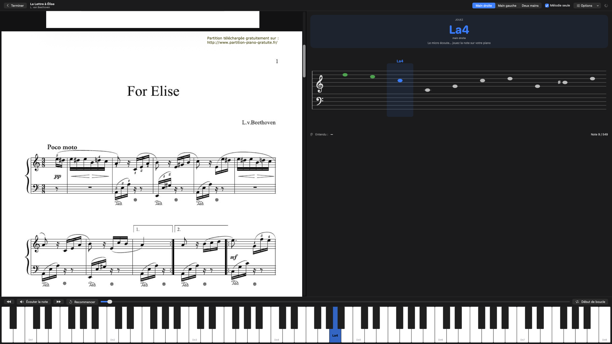
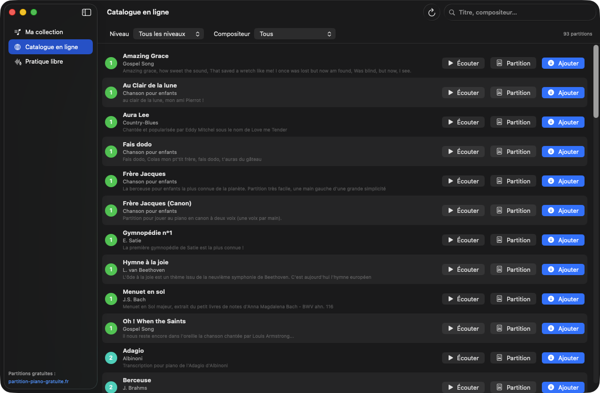
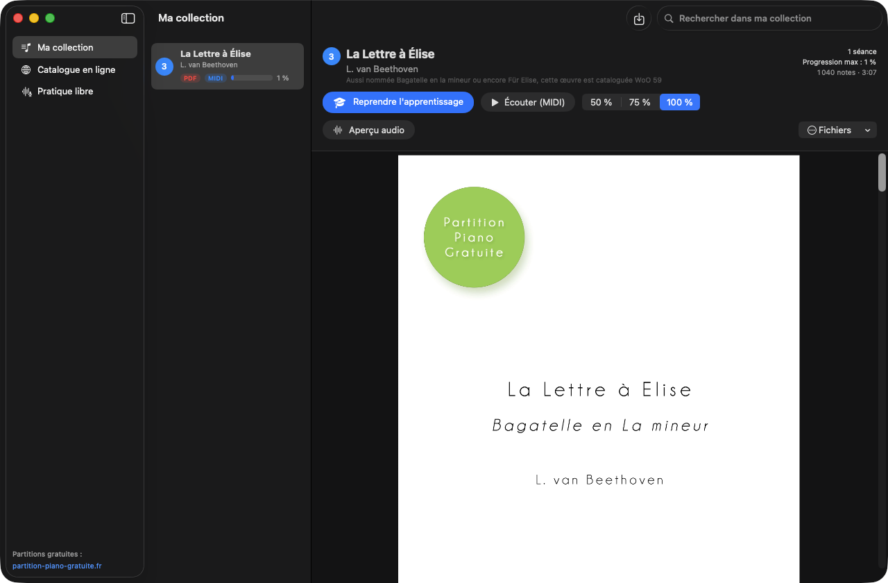

# Piano Learning 🎹

A macOS app for learning the piano one piece at a time. It listens to your piano through the microphone and checks each note you play.

> The app's interface is in French.



## Download

Get [`exports/Piano-Learning-1.1-macOS.zip`](exports/Piano-Learning-1.1-macOS.zip). It runs on macOS 14 (Sonoma) or later, on both Apple Silicon and Intel Macs.

1. Unzip it and drag **Piano Learning.app** into your Applications folder.
2. The app isn't signed by an identified Apple developer, so macOS blocks it the first time you open it. To allow it, open it once, then go to **System Settings › Privacy & Security** and click **Open Anyway**. You can also run this in Terminal:
   ```bash
   xattr -dr com.apple.quarantine "/Applications/Piano Learning.app"
   ```
3. Allow microphone access when the app asks for it. Note detection needs it.

## Features

- **Online catalogue**: every free score from [partition-piano-gratuite.fr](https://www.partition-piano-gratuite.fr/), plus about forty classical pieces from the [Mutopia Project](https://www.mutopiaproject.org/) and [Wikimedia Commons](https://commons.wikimedia.org/) (Chopin, Schumann, Grieg, Bach, Mozart, Beethoven, Schubert…), with level, composer and source filters and search. The classical list is built into the app (`ClassicsCatalog.swift`) and only holds public-domain or freely licensed editions; files are downloaded from their source when you add a piece, and each entry credits its edition and licence. You can play a preview (the MP3, or the MIDI file on the built-in piano for pieces without one), view the PDF, and add a piece to your collection in one click (this downloads the PDF and the MIDI file).

  

- **My collection**: pieces you downloaded or imported (PDF, MIDI, MusicXML `.musicxml/.mxl`). You can import with the *Import* button (⌘O), by drag and drop, or with "Open With" in the Finder. A PDF and a MIDI file with the same name are grouped together. When you import a PDF on its own and it matches a catalogue entry, the app fetches its MIDI file for you.

  

- **Learning (wait mode)**: the app shows the note to play by name, on a treble/bass staff and on the keyboard. It listens through the microphone and **moves on only when you play the right key**. Wrong notes are flagged. Accuracy and progress are saved, and you pick up where you left off.
  - right hand, left hand or both hands; melody only or full chords
  - hear the note (Space), skip (→), go back (←), loop a difficult passage
  - **listen to the piece in rhythm** (P) from the current note, or just the looped passage: the staff and keyboard follow along, at 40–125 % speed, with the whole piece or only the hand you practise
  - **metronome** (M) with a swinging pendulum and beat lights: it uses the piece's time signature and tempo, follows the playback, and can be silent (visual only) so it never interrupts the microphone
  - "any octave" option, microphone sensitivity and microphone choice
  - the PDF score is shown next to the lesson
  - the on-screen keyboard always shows all 88 keys, like a real piano, so it never shifts while you play
  - USB/Bluetooth MIDI keyboards (digital pianos such as the Alesis Recital) are supported, with exact detection: plug in the cable and the app reads the keys directly, the microphone is then ignored. The keys you play also sound on the Mac with its piano voice and your sustain pedal (Settings can turn this off)
- **Learn from a PDF alone**: optical music recognition with [Audiveris](https://audiveris.github.io), a free tool you can install from the app in one click. Results are reliable on simple scores and approximate on dense ones.
- **Listen to a piece**: MIDI piano playback at 50/75/100 % speed, with the keys lighting up.
- **Free play**: the microphone shows the note you're playing (with tuning) while you read a score.

## Build and run

You need macOS 14+ and the Command Line Tools. Xcode isn't required.

```bash
scripts/build_app.sh            # builds build/Piano Learning.app
open "build/Piano Learning.app"
scripts/build_app.sh --install  # also copies the app to /Applications
scripts/package.sh exports      # universal zip (Apple Silicon + Intel) in exports/, for another Mac
scripts/test.sh                 # tests (parsers, pitch detection, end-to-end audio tests)
```

## Tips for microphone detection

- The app only reacts to sounds shaped like piano notes: a steady pitch that fades after the key is struck. Talking and room noise are ignored. If some notes of your piano aren't recognised, turn off "Ignorer la voix et les bruits" in *Options* or in Settings (⌘,).
- Put the microphone close to the piano. A gaming headset mic with noise cancellation can filter out the piano, so a USB mic or a MacBook's built-in mic works better. You can choose the microphone in *Options* or in Settings (⌘,).
- Start with "Main droite" (right hand) and "Mélodie seule" (melody only). Chords are detected, but single notes are detected most reliably.
- The app stops listening while it plays a sound itself, so it can't validate its own notes.

## Architecture

- `Sources/PianoCore`: testable logic. It covers MIDI/MusicXML reading, MIDI writing, splitting a piece into steps (hands, chords), pitch analysis (YIN + harmonic spectrum), `PianoToneFilter` (tells piano notes from voice and noise), `NoteMatcher` (right/wrong decision) the catalogue parser and the built-in list of public-domain pieces.
- `Sources/PianoLearning`: the SwiftUI app. It contains the catalogue, collection, lesson and free play screens, the audio engine (the macOS GM piano sampler), microphone input, MIDI keyboard input and Audiveris OCR.
- `PIANO_TEST_AUDIO=file.wav` replaces the microphone with an audio file, so you can test a lesson without a piano. Add `PIANO_TEST_AUDIBLE=1` to hear it.
